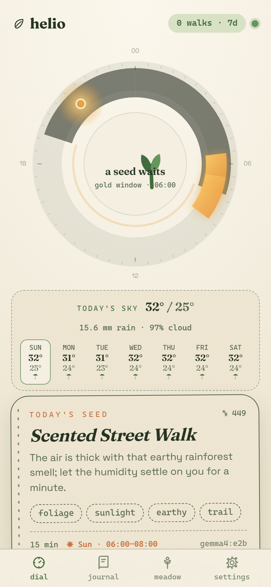
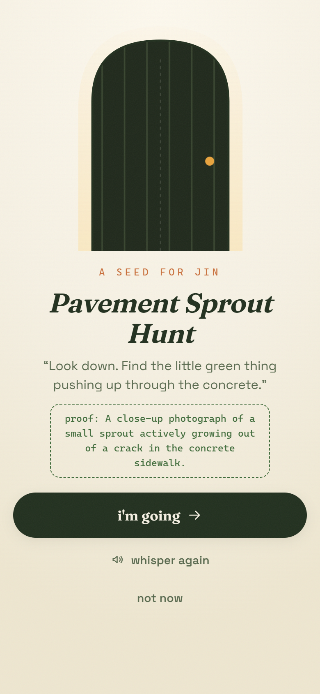
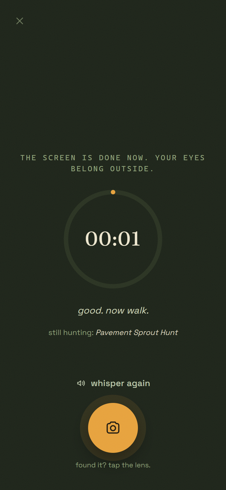
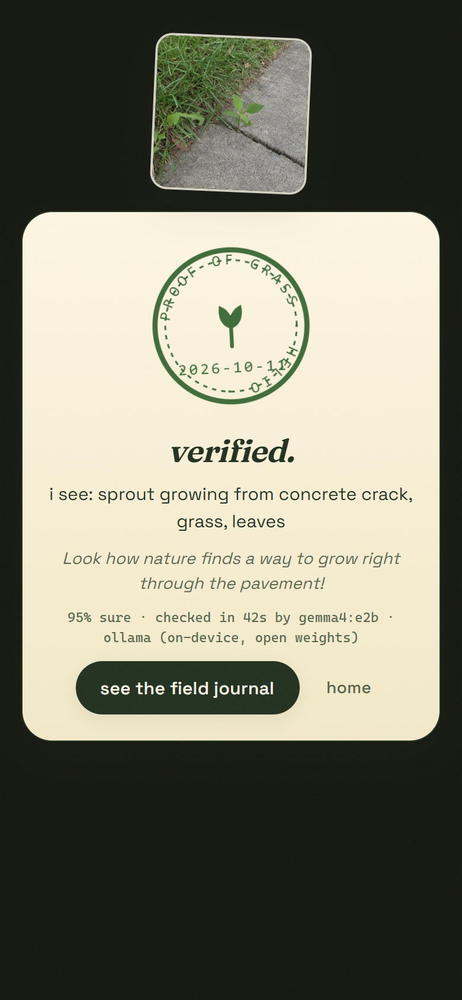
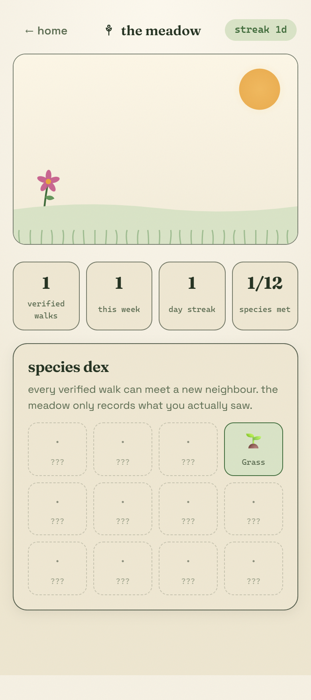
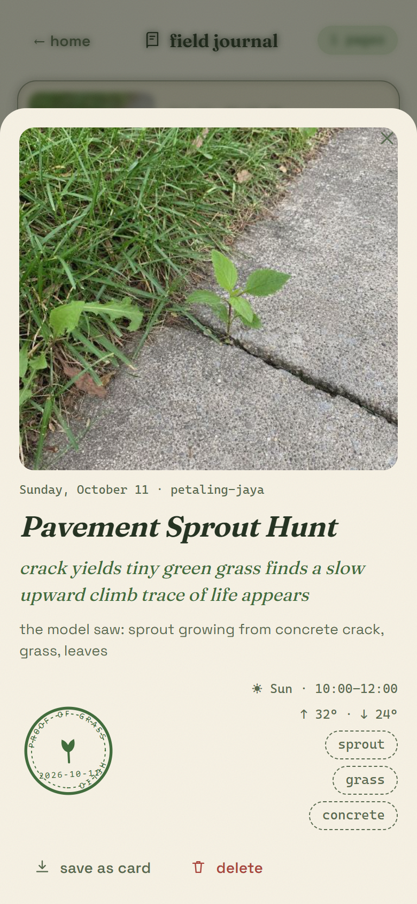

# Helio: an open-weight AI that makes you touch grass — and refuses to believe you did

*Week 1 of the DEV × Hacktoberfest Open-Source AI Challenge: Touch Grass.*

<!-- TAGS: #devchallenge #hf26challenge #hacktoberfest #softwaredevelopment -->

> A photo of your keyboard does not count. I checked.

## What I Built

**Helio** is an offline-first PWA that gets you off the screen and into the world — built on
open-weight models, running on your own machine. It does two jobs no other outdoors app
does:

1. **It tells you *when* to go.** A tiny tabular foundation model — **TabPFN** — reads ten
   years of your city's weather history plus the days you personally walked, and scores the
   next seven days for grass-worthiness. On CPU. In about a second. No training loop —
   it learns in-context.
2. **It verifies that you actually went.** When you come back and photograph what you
   found, a local **Gemma** vision model checks the photo against the mission's proof
   criteria — *on your device*. No upload. If the photo is your desk, the verdict is
   "not grass".

Reviewing the loop visually — the dial that reads a decade of weather, the door that hands
you one whisper, the pocket screen that sends you away, the stamp that only a real photo
earns:



Between those two poles sits the experience:

- **the dial** — a sun-compass that lights up the best outdoor hours of today; one tap on
  *use my location* pins the nearest supported sky
- **the door** — a Mastra + Gemma *mission compiler* writes you a tiny whispered
  assignment ("Find the oldest standing thing within walking distance…"), and a
  **Temporal workflow** holds that mission on a durable timer until its grass window
- **the pocket screen** — literally tells you the screen is done now
- **the proof** — the on-device verdict, stamped with confidence and what the model saw
- **the journal & meadow** — every verified walk gets a 5-7-5 haiku and grows a meadow
  with a 12-species field dex

The design rule from commit one: **every dependency is a leaf node**. Sever any edge of
the graph and the product still works, labelled honestly — the dial shows climatology when
the model is away, hand-written seeds walk in when the LLM is down, the browser reads the
whisper when the voice API is missing. It survives airplane mode, backcountry, and a dead
wifi router — which is exactly what an outdoors app should do. *(Fun failure mode: it
also survives the wrong photo. Try your keyboard.)*

## Demo

- **Live:** https://helio-agent.onrender.com (free Render instance — first load may take ~1 min to wake)
- **Repo:** https://github.com/JinYi123456/helio
- **70-second walkthrough:** [helio-demo.mp4](https://github.com/JinYi123456/helio/blob/main/submission/assets/helio-demo.mp4) — the whole loop recorded live: the mission compiled by Gemma, held on a Temporal timer, the photo verified on-device, the meadow grown
- 90-second local run:

```bash
npm ci
ollama pull gemma4:e2b
npm run dev
```

On a laptop with no camera, the proof screen falls back to file upload — the app treats
that as a first-class path, not an error.







The meadow only grows on verified walks — twelve species to meet, one streak to keep
alive without lying:



## Code

Three services, one loop:

```
apps/web            Vite + React PWA — dial · door · pocket · proof · journal · meadow
services/agent      Hono + Mastra — mission compiler agent, vision verifier, haiku, TTS
services/tabpfn     FastAPI — TabPFN grass-window model + precompute baker
services/tinker     Python — dataset builder + LoRA fine-tune of Helio's whisper voice
```

The grass window is the heart. The whole preference chain is ~20 lines:

```python
# services/tabpfn/app/service.py
if precompute_only:                      # tiny host? serve the bake
    return load_precomputed(city_key)
try:
    model = get_model(city_key)          # TabPFN, in-context, on CPU
    scores = model.predict_days(df)
    served = "model"
except Exception:
    _mark_model_failed(city_key)         # 600s cooldown — never retry-storm
    try:
        pre = load_precomputed(city_key) # bake wins next
        pre["served"] = "precomputed-fallback"
        return pre
    except FileNotFoundError:
        scores = heuristic_scores(df, city_key)   # still honest
        served = "heuristic"
```

The mission compiler is one Mastra agent with three tools (grass window, local ground
notes, field memory) and a zod'd draft schema. Every mission — model-written or fallback —
carries **photo-checkable proof criteria**, because a mission you can't verify isn't a
mission, it's a vibe.

The vision verdict comes back as strict JSON and is clamped on the way in — a model that
hallucinates "confidence: 500" can't stamp anything:

```ts
// services/agent/src/lib/vision.ts
export function verdictFromRaw(raw: unknown, engine: string, ms: number): Verdict {
  // … clamp confidence to [0,1], default `seen`, mark `loose` when the
  // pass/fail flag is missing rather than trusting the model's prose.
}
```

Tests are the contract: **33 vitest specs** across tools, verdicts, windows, seeds and
the durability layer, plus **13 pytest specs** for the forecast chain (all running
against the real license-accepted model — see below). CI runs both on every push, and a
daily GitHub Action re-bakes the grass windows on the real model and commits the JSON —
the free-tier host just serves the bake.

## How I Built It

**Grounded in the real runtime, not in guesses.** Every claim in this section was verified
by running the thing: model versions, ports, timings, and every failure below is a real
failure from the build log (kept in `docs/building-log.md`).

And when the walk ends, the local model writes it a 5-7-5 haiku and files it away —
photo, verdict, weather, stamp, tags:



1. **TabPFN's weights are license-gated.** The first server boot tried to open a browser
   for a one-time license acceptance at 2 AM — and hung waiting on stdin. A server must
   never block on an interactive login. Fix that became a feature: `TABPFN_NO_BROWSER=1`,
   a 600-second failure cooldown, and the fallback chain above. The polite fix for tiny
   hosts: `app/precompute.py` bakes windows by hand or in CI; a daily Action refreshes
   them so the hosted demo always serves fresh, model-scored JSON.
2. **Thinking models don't stop thinking.** `gemma4:e2b` is a thinking model — without
   suppression it burns its whole budget reasoning and never answers. On Ollama's native
   API `think:false` fixes it; over the OpenAI-compatible endpoint you inject
   `reasoning_effort:"none"` via `transformRequestBody`. Verified: three clean tokens back
   instead of a 4,000-token monologue. It's in the code as a provider-scoped transform.
3. **Your walks post-date the weather archive.** Personal "I walked today" labels were
   silently matching nothing — the archive ends before today. Fix: synthesize feature rows
   from the walk-time weather (which the app records anyway) and fill the rest from
   same-day climatology. Now the model actually learns *your* good days.
4. **React StrictMode raced the mission compiler.** Dev double-mount meant two ~70-second
   Gemma missions started in parallel; one finished and rendered, the other overwrote
   state — same walk, two different mission titles. An in-flight ref guard fixed it.
   Production was never affected, but a confused user would have been — and a confused
   *me* at 3 AM definitely was.
5. **Free instances are 512MB; torch is not.** So the deployed grass-window service
   deliberately does not install tabpfn — it serves CI-baked windows, recomputes
   live forecasts when it can, and keeps heuristic scoring as the floor. Zero paid
   anything, honest `served` field on every response so you always know which layer
   answered.
6. **Sentry's "one-line" Mastra integration silently did nothing.** Node reads an ESM
   module graph *before* any module body runs, so `init()` called from app code lands
   after `@mastra/core` has already loaded — and already-loaded modules are never
   instrumented. The fix that made it real: a four-line, DSN-gated
   `node --import` preload, plus a constructed `Mastra` instance (a lone `Agent` emits
   nothing to an exporter). Verified against exactly what Render runs: every compile is
   now one `gen_ai` trace with token usage — and with no DSN, Sentry never enters the
   process at all.
7. **A mission is a promise with a deadline — that's a workflow, not a cron.** "Walk when
   the window opens, prove it before it closes" is exactly the shape Temporal exists for,
   so every compiled mission starts a `missionLifecycle` workflow: sleep until the
   TabPFN-picked golden hour, a 6-hour expiry, and one `markDone` signal the verifier
   fires when your photo passes. The workflow races `sleep()` against `condition(done)`
   and honestly returns `"verified"` or `"missed"`. Verified for real: a mission that
   signalled during its sleep completed as `Result: "verified"` (2m33s wall time, timer
   cancelled), and a probe workflow woke at its golden hour, POSTed a `ripe` event back
   into the agent, then closed as `"missed"` — all visible in the Temporal UI. With no
   `TEMPORAL_ADDRESS`, the mission still compiles and the API says
   `lifecycle: { scheduled: false }` — leaf node, as promised.

## What It Can't Do (Yet)

Honest limits, because the meadow only grows on verified walks:

- **It can't prove *you* took the photo.** The vision check verifies content, not
  authorship — no location attestation, no sensor checks. A determined cheater with a
  stock photo of moss could still fool it. Helio is a nudge with a memory, not a cop.
- **The hosted demo covers three cities.** The model itself takes any city; Petaling
  Jaya, Seattle and Zürich are what the free-tier bake keeps fresh. Tap *use my
  location* and Helio picks whichever is nearest — with an honest distance note when
  you're far from all three.
- **The deployed window service serves precomputed scores.** Torch doesn't fit a 512MB
  free instance, so the real model runs in the daily GitHub Action bake and the service
  recomputes live forecasts on top — the `served` field always tells you which layer
  answered.
- **On-device verdicts take ~45 seconds on CPU.** That's the honest price of the photo
  never leaving your machine. The hosted demo uses cloud Gemma instead; locally, put the
  kettle on while it judges your grass.
- **No accounts, no cross-device sync** unless you point it at MongoDB Atlas; photos and
  logs live in your browser's IndexedDB, exportable and burnable by you.
- **The hosted demo doesn't run a Temporal cluster.** Durable lifecycle timers need a
  Temporal server next to the worker (`temporal server start-dev` + `npm run
  temporal:worker`); on the hosted build `/api/health` reports `temporal: false` and
  missions are simply not scheduled — everything else works.

## Why Does Open Innovation Matter?

Every app that "helps you go outside" should itself be able to survive outside. Closed,
server-dependent AI fails exactly when you need it most — on a mountain, on a plane, at
the edge of a network. Helio inverts the default: the model runs on your machine, your
photos never leave the device, and the whole thing costs nothing to run because there's
nothing to meter.

There's also a philosophical bit I care about: an app that gamifies touching grass
shouldn't demand that you stare at it. Helio's pocket screen literally sends you away.
Its memory of your walks lives in your browser's IndexedDB, exportable and burnable by
you. The weights are open — ollama today, llama.cpp tomorrow, the model belongs to
everyone. When the product's pitch is "own your attention", the stack should practice
what it preaches. That's what open weights make possible: a tool that can be *entirely
yours*.

## My Agent Session

I built Helio in an agentic coding session, and the most useful pattern was treating the
agent as an accountable colleague rather than an autocomplete:

- **Research before code.** The session started with the partner stack: what TabPFN
  actually is (in-context tabular foundation model — perfect for weather+habit scoring),
  which ports were free, which model names were real. Several "obvious" choices died in
  research rather than in code.
- **Everything ran for real.** No mocked model calls. The full loop was walked in a
  browser against real services — the screenshots in this post are that session, including
  a real sprout photo stamped **95% sure, checked in 44.5s on CPU** — and a keyboard photo
  was **correctly rejected** on an earlier pass.
- **Errors became features.** The three nastiest bugs (license-gated weights, thinking
  token burn, StrictMode race) each ended up *shaping the architecture* — the cooldown,
  the provider-scoped transform, the in-flight guard. That's the log in
  `docs/building-log.md`, kept unedited.
- **Tests as the contract.** Before touching the vision normalizer or the fallback chain,
  specs existed for the ugly cases: null garbage, confidence clamping, missing flags,
  single-hour windows. The agent's output could then be trusted precisely where trust
  was earned.

The honest version: the agent was brilliant at breadth (research, scaffolding, tests) and
needed supervision at depth (the 2 AM browser-hang was *my* reviewer instinct catching a
hang the code was happy to wait out). The best results came from the loop — build,
verify on the real runtime, and let the failures teach.

## Prize Categories

All 16 partner categories, with receipts where Helio truly uses the tech (every one of
them degrades gracefully when absent — try removing any):

| Category | In Helio |
|---|---|
| **Render** | `render.yaml` blueprint: agent (Node, serves the PWA) + grass-window service (Python, precompute mode). Free tier, two services, one blueprint. |
| **TabPFN** | The grass window itself — in-context over 10y of weather, personal labels from real walks, CPU inference, license-aware fallback chain. |
| **Gemma** | Two jobs: the mission compiler (via Mastra) and the photo proof verifier — both on-device via Ollama. |
| **Mastra** | The mission compiler agent: three tools, multi-step, structured draft + repair pass. |
| **ElevenLabs** | Whisper TTS for missions, disk-cached; falls back to browser speech. |
| **SerpApi** | "What's in season right now" ground notes folded into missions. |
| **MongoDB Atlas** | Field memory over walk notes — `$vectorSearch` when configured, RAM otherwise. |
| **Sentry** | Real agent tracing: a DSN-gated `--import` preload wires runtime instrumentation, so every mission compile lands in Sentry as one trace — `http.server → mission.compile → gen_ai.invoke_agent → gen_ai.chat → http.client` — with model name, input messages and token usage as `gen_ai.*` attributes. API errors are captured too. |
| **Tinker** | Helio's whisper voice as a trainable artifact: `services/tinker/` distills the hand-written field corpus into context→whisper pairs and fine-tunes a small open-weight model over Tinker's SDK; the agent then samples whispers through Tinker's OpenAI-compatible endpoint. Wired end-to-end and env-gated — the training run is waiting on the account's billing/credit activation. |
| **Temporal** | The durable mission lifecycle: every mission is a `missionLifecycle` workflow — timer to the TabPFN-picked golden hour, 6-hour expiry, `markDone` signal from the verifier. Verified locally end-to-end: signal → `Result: "verified"`; timer → `ripe` + `missed` events posted back to the agent. No `TEMPORAL_ADDRESS`? The mission compiles anyway, honestly unscheduled. |
| **Tiger Data** | The time-series shadow of the meadow: walks land in a `footprints` hypertable (TimescaleDB, via `pg`) and `GET /api/footprints` returns the server-side 7-day series. Wired end-to-end and env-gated: no `TIGER_URL` → the endpoint answers `{enabled:false}` and the app is untouched; with a URL it's one key away. |
| **DigitalOcean** | Not used this week — Render carries the hosted demo. |
| **Backboard** | Not used — Helio's memory layer must run offline-first; a hosted control plane is against the grain. |
| **Entire** | Not used. |
| **GitHub Copilot** | Not used — the session ran in Qoder. |
| **Arduino** | Not used — no hardware in this build… yet. A sun-dial lamp that glows when your window opens is the obvious next step. |

---

*Helio: proof of grass. MIT-licensed, photos never leave your device, and the meadow only
grows when you actually go. See you outside.*
